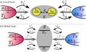
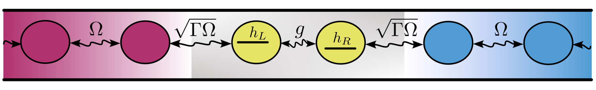

# Unraveelings of a Non-Additive Master Equations in Lindblad Form

## Authors
Main contributors: Ilia Khomchenko, Emanuel Schwarzhans  2026

## License
Оpen source project.

## Summary

In this project, we invesigate the unravelling of a quantum master equation with cross-terms not in Lindblad form. A series of plots illustrates this point, presenting no-jump quantum map, the average stationary-state current and its fluctuations for various parameters in the case of an open quantum system connected with two thermal reservoirs. The open quantum system is comprised by two fermionic modes that are coherently-coupled with each other. All the calculations are performed in the stationary state of the open quantum system, which is assumed to be unique. 

## Illustrations 

Double quantum dot connected to two fermionic reservoirs, denoted as a system $S$. Each dot contains only one energy level $h_{L,R}$ and the dots are coherently coupled with tunnel coupling $g$. Both dots can exchange particles independently with reservoirs ($L,R$) at temperatures $T_{L,R}$ and chemical potentials $\mu_{L,R}$, respectively. The double-dot quantum system is coupled to the two thermal baths, which ensures stationery-state  currents $\langle J \rangle_{L,R}$ flowing through the system. The upper panel sketches the setup in the local basis and the lower panel in the global basis. The rates $`\overline{\gamma}^{\pm}_{\alpha}`$ in the upper panel, characterise the jump processes between the reservoirs and the individual site $\alpha$; whereas, in the lower panel, the rates $\gamma^{\pm}_{\alpha, j}$ describe the jump processes between the reservoirs and the energy eigenstates of the Hamiltonian in Eq.(1) of the open system.

## Installation

1. Clone the repository:

`git clone <YOUR_REPOSITORY_URL>` # Replace with your repo URL

2. Create a virtual environment (recommended):

`python -m venv venv`

`source venv/bin/activate`  # On Windows use 'venv\Scripts\activate'

3. Install dependencies: Ensure you have Python 3.x installed. Install the required packages using the `requirements.txt` file:

`pip install -r requirements.txt`

## Instalation for a high perfomace computer (HPC) to get Fig 2.

1. Clone the repository to the desired HPC:

`git clone <YOUR_REPOSITORY_URL>` # Replace with your repo URL

2. Create a local virtual environment (recommended):

`python -m venv venv`

`source venv/bin/activate`  # On Windows use 'venv\Scripts\activate'

3. Install dependencies: Ensure you have Python 3.x installed. Install the required packages using the `packages.txt` file:

`pip install -r packages.txt`

4. Use `Slurm` commands to put your job in a queue `squeue phd.sh` via the provided scrip `phd.sh` to get Fig. 2.

## Examples

`Figs3467_visualisation.ipynb` reproduces Figures 3, 4, 6, 7 from the manuscript.  

`Fig8_visualisation.ipynb` includes plots of the average stationary-state particle current, its fluctuations, and other quantities considered as a function of the detuning $\delta$ of energy levels of dots.

`Fig9_visualisation.ipynb` includes plots of the average stationary-state particle current, its fluctuations, and other quantities considered as a function of the interdot coupling $g$.

`Fig2_visualisation.ipynb` includes the plot of the "phase diagram", i.e. Fig. 2 from the manuscript.

`Fig10_visualisation.ipynb` reproduces Fig. 10 showing how different current in the local and global bases are.

`Fig12_visualisation.ipynb` reproduces Fig. 12 showing how small cross-terms of the non-additive master equation are.

`Fig13_visualisation.ipynb` reproduces Fig. 13 with the results of agreement between current in the Landauer-B\"uttiker and the Quantum-Master-Equation approaches.  

`Rates_fig2_figs11.ipynb` the graphs with gain and loss rates of Fig. 2 to reproduce Fig. 9.  

